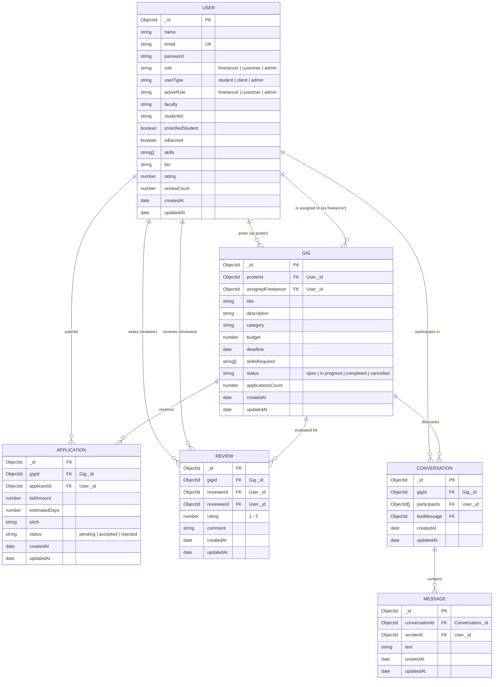

# GigLoop — Campus Freelance & Micro-Gig Marketplace
**EC4307 Web Application Development — Mini Project**

GigLoop is a full-stack campus freelance marketplace connecting university students with peers, faculty, and local clients for micro-gigs, design projects, software development, academic tutoring, and creative services.


---

## Main Entity CRUD Summary (Entity: `Gig`)

| Operation | Action | User Interface | Backend API Endpoint |
| :--- | :--- | :--- | :--- |
| **Create** | Post a new gig listing | [PostGig.jsx](file:///d:/Uni%204TH%20sem/WEB/ART%20GIG/GigLoop/frontend/src/pages/PostGig.jsx) | `POST /api/gigs/create` |
| **Read** | List, search, filter, sort & view details | [Feed.jsx](file:///d:/Uni%204TH%20sem/WEB/ART%20GIG/GigLoop/frontend/src/pages/Feed.jsx), [Dashboard.jsx](file:///d:/Uni%204TH%20sem/WEB/ART%20GIG/GigLoop/frontend/src/pages/Dashboard.jsx) | `GET /api/gigs/all`, `GET /api/gigs/:id`, `GET /api/gigs/my-posted` |
| **Update** | Edit gig title, description, budget, deadline, skills | [EditGigModal.jsx](file:///d:/Uni%204TH%20sem/WEB/ART%20GIG/GigLoop/frontend/src/components/EditGigModal.jsx) | `PUT /api/gigs/:id` |
| **Update (Status)** | Mark completed or cancel gig | [Dashboard.jsx](file:///d:/Uni%204TH%20sem/WEB/ART%20GIG/GigLoop/frontend/src/pages/Dashboard.jsx) | `PUT /api/gigs/:id/status` |
| **Delete** | Remove gig and cascade proposals | [Dashboard.jsx](file:///d:/Uni%204TH%20sem/WEB/ART%20GIG/GigLoop/frontend/src/pages/Dashboard.jsx), [Feed.jsx](file:///d:/Uni%204TH%20sem/WEB/ART%20GIG/GigLoop/frontend/src/pages/Feed.jsx) | `DELETE /api/gigs/:id` |

---

## Entity Relationship Diagram (ERD)



---

## Technology Stack

- **Frontend**:
  - React 19 + Vite 8
  - React Router DOM 7
  - Axios (HTTP client with request/response interceptors)
  - Socket.io Client (Real-time private chat)
  - Modern CSS design system (Responsive utilities, cards, badges, modal dialogs)
- **Backend**:
  - Node.js & Express 5
  - MongoDB & Mongoose 9
  - JSON Web Tokens (`jsonwebtoken`) & `bcrypt` for authentication & password hashing
  - Socket.io 4 for real-time messaging
  - Dotenv & CORS
- **Database**:
  - MongoDB (Persistent NoSQL database with Mongoose ODM schemas, compound indexes, and ACID multi-document transactions)

---

## Setup & Installation Instructions

### Prerequisites
- [Node.js](https://nodejs.org/) (v18 or higher recommended)
- [MongoDB](https://www.mongodb.com/) (Local instance running or MongoDB Atlas connection string)
- Git

### 1. Clone the Repository
```bash
git clone <your-repository-url>
cd GigLoop
```

### 2. Backend Setup
Navigate to the `backend` folder:
```bash
cd backend
npm install
```

Create a `.env` file in the `backend/` folder:
```env
PORT=5000
MONGO_URI=mongodb://localhost:27017/gigloop
JWT_SECRET=your_super_secret_jwt_key_here_12345
```

Start the backend server:
```bash
# Production / standard start:
npm start

# Or with automatic reload:
npm run dev
```
The backend server will run on `http://localhost:5000`.

### 3. Frontend Setup
Open a new terminal and navigate to the `frontend` folder:
```bash
cd frontend
npm install
```

(Optional) Create a `.env` file in the `frontend/` folder if you need custom API URLs:
```env
VITE_API_URL=http://localhost:5000/api
VITE_SOCKET_URL=http://localhost:5000
```

Start the Vite development server:
```bash
npm run dev
```
Open your browser at `http://localhost:5173`.

---

## REST API Specification

### Authentication & Users (`/api/auth`)
| Method | Endpoint | Access | Description |
| :--- | :--- | :--- | :--- |
| `POST` | `/api/auth/register` | Public | Register student (`@*.ac.lk`) or client account |
| `POST` | `/api/auth/login` | Public | Login and receive JWT token |
| `GET` | `/api/auth/me` | Authenticated | Retrieve current user profile |
| `PUT` | `/api/auth/switch-role` | Authenticated | Toggle active role (`freelancer` ↔ `customer`) |
| `PUT` | `/api/auth/profile` | Authenticated | Update bio, skills, and faculty |

### Gigs (`/api/gigs`) — Main Entity
| Method | Endpoint | Access | Description |
| :--- | :--- | :--- | :--- |
| `POST` | `/api/gigs/create` | Authenticated | **Create** a new gig listing |
| `GET` | `/api/gigs/all` | Public | **Read** all gigs with search, filter (category, status, budget) & sort (newest, oldest, budget, deadline) |
| `GET` | `/api/gigs/my-posted` | Authenticated | **Read** gigs posted by the logged-in user |
| `GET` | `/api/gigs/:id` | Public | **Read** single gig details |
| `PUT` | `/api/gigs/:id` | Poster / Admin | **Update** gig details (title, description, budget, deadline, skills) |
| `PUT` | `/api/gigs/:id/status` | Poster / Admin | **Update** gig status (`completed` or `cancelled`) |
| `DELETE`| `/api/gigs/:id` | Poster / Admin | **Delete** gig safely with cascading proposals cleanup |

### Proposals & Applications (`/api/applications`)
| Method | Endpoint | Access | Description |
| :--- | :--- | :--- | :--- |
| `POST` | `/api/applications/:gigId/apply`| Student | Submit proposal/bid for an open gig |
| `GET` | `/api/applications/my-applications`| Authenticated | View proposals submitted by user |
| `GET` | `/api/applications/gig/:gigId` | Poster | View proposals submitted for a gig |
| `PUT` | `/api/applications/:id/status` | Poster | Accept or reject a proposal (hires freelancer) |
| `DELETE`| `/api/applications/:id` | Applicant | Withdraw a pending proposal |

### Reviews (`/api/reviews`)
| Method | Endpoint | Access | Description |
| :--- | :--- | :--- | :--- |
| `POST` | `/api/reviews` | Authenticated | Submit rating (1-5) and review for a completed gig |
| `GET` | `/api/reviews/user/:userId` | Public | View received reviews and calculated average rating |
| `GET` | `/api/reviews/gig/:gigId` | Authenticated | Get reviews submitted for a specific gig |

### Admin Moderation (`/api/admin`)
| Method | Endpoint | Access | Description |
| :--- | :--- | :--- | :--- |
| `GET` | `/api/admin/stats` | Admin | Get platform statistics and metrics |
| `GET` | `/api/admin/users` | Admin | List all registered users |
| `PUT` | `/api/admin/users/:id/ban` | Admin | Suspend or reactivate user account |
| `PUT` | `/api/admin/users/:id/verify-student` | Admin | Verify student credentials |
| `GET` | `/api/admin/gigs` | Admin | View and moderate all campus gigs |


